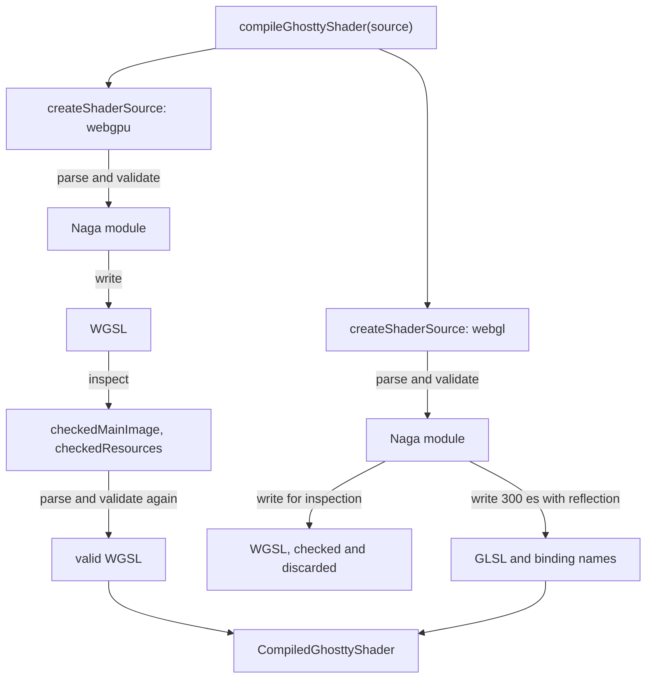

# How it works

This page explains what happens inside `compileGhosttyShader`, why a ShaderToy shader needs a wrapper, and why the coordinate and texture rules are what they are. For exact signatures and bindings, see the [reference](../reference/api.md).

## One source, two programs

A Ghostty shader is GLSL that defines `mainImage`. A browser cannot run GLSL on WebGPU, which takes WGSL, and WebGL2 wants GLSL ES 3.00 with its own binding rules. The package turns one source into both, so a shader written for desktop Ghostty has a path to either browser API.

[Naga](https://github.com/gfx-rs/wgpu/tree/trunk/naga), the shader translator from the wgpu project, does the parsing, type checking, and code generation. It runs as WebAssembly through `naga-wasm`. The package writes no GLSL parser of its own. That choice has a cost: whatever Naga's GLSL front end rejects, this package rejects. [ADR 001](../adr/001-compile-with-naga-in-webassembly.md) records the reasoning.

## What a compile does

The shader compiles twice. The two runs differ in one prefix: the WebGPU run negates `dFdy`, `dFdyFine`, and `dFdyCoarse`. WGSL's framebuffer Y axis points down, and Ghostty's GLSL derivatives assume Y points up. Without the macro, a shader that reads `dFdy` would see the opposite sign on WebGPU.

### Wrapping the source

`createShaderSource` does not hand your code to Naga as it is. It builds one GLSL 450 text from three parts:

1. **A prefix.** It declares the std140 uniform block at set 0, binding 0, the `iChannel0` texture at binding 1 and its sampler at binding 2, and one fragment input and one output at location 0. Macros map `iChannel0` to `sampler2D(texture, sampler)`, `texture2D` to `texture`, and `gl_FragCoord` to the bottom-left pixel coordinate. The `CURSORSTYLE_*` constants are defined here as well.
2. **Your code**, edited so that every line and column stays put. The package replaces precision qualifiers (`highp` and the others) and your `#version` line with spaces, because Naga rejects precision qualifiers in function parameters and the prefix sets the version. Both backends use 32-bit floats. The package also rejects any identifier that begins with `_ghostty` outside comments, because the prefix uses that namespace.
3. **A suffix.** It defines `main`, which copies the scalar array uniforms into ordinary arrays and calls `mainImage(_ghosttyColor, _ghosttyUv * iResolution.xy)`.

Because the prefix has a known length, the package can subtract it from every position Naga reports. That is why a diagnostic says line 2 of your file instead of line 61 of the wrapped text. If Naga reports a position inside the suffix, you defined your own `main`, and the package reports a contract error instead.

### Checking the contract

After Naga writes WGSL, the package reads that WGSL against a short list: a `mainImage` with the expected signature, no resource other than binding 0 (uniforms), 1 (texture) and 2 (sampler) in group 0, no input or output other than location 0, and no depth or sample-mask output. `iChannel1` never gets this far, because the prefix does not declare it and Naga reports an unknown variable. A shader that declares a resource of its own fails in Naga or at this check, depending on how it declares it. See [the decision to support one image pass](../adr/003-one-image-pass-with-ichannel0.md).

The check runs on text with regular expressions. It is not a full parse of WGSL, and it is as strict as the WGSL that Naga happens to write.

## Coordinates

The fragment input at location 0 is a UV in the range 0 to 1, with the origin at the bottom left of the output. `fragCoord` is that UV times `iResolution.xy`, so it counts physical pixels from the bottom left. A direct read of `gl_FragCoord` gives the same value, with Z zero and W one.

`FULLSCREEN_VERTEX_WGSL` and `FULLSCREEN_VERTEX_GLSL` produce that UV from `vertex_index` with one oversized triangle, so your draw call is `draw(3)` with no vertex buffers.

## Texture orientation

`iChannel0` reads row zero as the bottom row of the picture, in both APIs. In WebGL2 a texture uploaded with `texImage2D` already stores its first row at t = 0, so a bottom-first buffer needs no change, and a top-first source such as a canvas needs `UNPACK_FLIP_Y_WEBGL`. WebGPU does the same in its own terms: texture row zero is v = 0, and the vertex shader puts v = 0 at the bottom of the screen. The guides draw one 2x2 test image through both APIs and show the same picture.

The package never touches pixels. If your source texture is top-first, flip it with a GPU render pass, as the showcase does when it captures the terminal canvas. Color space, alpha convention, filtering, and wrap mode are yours to choose, and the compiler applies no tone mapping or premultiplication.

## One uniform buffer for both APIs

Both APIs read the same std140 byte layout, so one `packShaderUniforms` call feeds either. The buffer is 4496 bytes. Most of that is `iPalette`, 256 `vec3` entries at 16 bytes each. A scalar array such as `iChannelTime` is stored as `vec4` entries because WGSL uniform arrays need a 16-byte stride, and the suffix copies it into a `float[4]` so your shader still sees a plain float array. The [uniform layout](../reference/uniforms.md) lists every offset, generated from the same table the packer uses.

## What the package leaves to you

The package compiles. It owns no render loop, no timers, no render targets, and no GPU resources. The showcase adapter in `examples/showcase/` shows one way to fill that gap:

- It coalesces terminal updates and animation ticks into one effect draw per browser frame.
- It allows one unfinished effect draw at a time, tracked by WebGPU queue completion or a nonblocking WebGL2 fence.
- It advances shader time by elapsed active time, and frame uniforms describe the draws that were actually submitted.

A costly shader still runs at a lower frame rate on a slower GPU. The adapter keeps stale frames from queuing behind it.

## Lifetime and concurrency

The first call loads the WASM module. Concurrent calls wait on the same load, and later calls reuse the instance. Naga's module and validation-info handles are freed explicitly after each compile, so the package does not depend on `Symbol.dispose`, which was missing in the Safari runtime it was tested on. A failed initialization is discarded, so a later call retries it.
