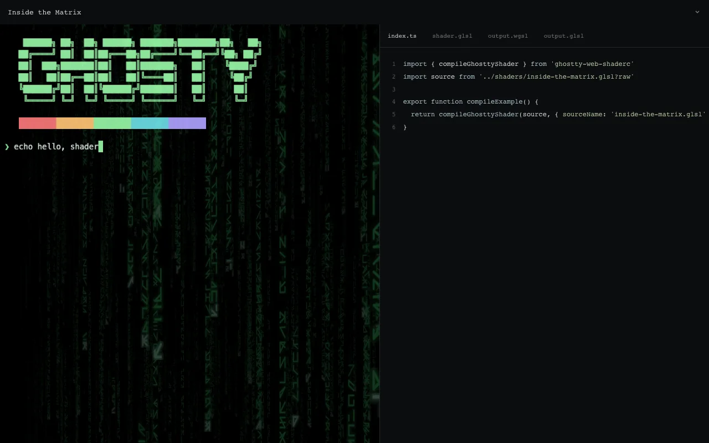

# How to run the live shader showcase

The showcase draws a scripted Ghostty terminal session through your choice of shader. Next to the terminal it shows the TypeScript entry point, the input GLSL, and the WGSL and GLSL that your browser just compiled. Every source pane is read-only. You can see it work before you write any code.

## Run it from a checkout

You need Bun 1.4.4 and a clone of the repository.

```sh
bun install --frozen-lockfile
bun run showcase:dev --port 4177
```

Open `http://127.0.0.1:4177/`. The command builds the package first, then starts Vite. Pick a shader from the menu in the top bar. The terminal redraws through the new shader, and the four tabs (`index.ts`, `shader.glsl`, `output.wgsl`, `output.glsl`) update.



The menu has a pass-through control named Regular and five shaders: Better CRT, Inside the Matrix, Fireworks, Water, and Cursor lightning. Compilation runs in your browser through `compileGhosttyShader` each time you select an example.

## Build a static copy

```sh
bun run showcase:build
```

The output is `.artifacts/showcase/`. It holds the JavaScript, both WASM files, the shader sources, and the license notices. Serve it from any static host over HTTPS or from localhost. Nothing is fetched from GitHub at run time.

## Check it

```sh
bun run typecheck:showcase
bun run showcase:build
bunx playwright install chromium
bun run test:showcase
```

`test:showcase` drives example selection, the generated-code panes, visible GPU output, the WebGL2 fallback, rapid switching, the narrow mobile layout, and visible load errors. It starts its own browser, server, and temporary profile, and removes them when it exits.

## Where the code lives

The sample integration is in `examples/showcase/`. Its terminal renderer is [ghostty-webgpu](https://github.com/ShaulLavo/fregat/tree/main/ghostty-webgpu), a dev dependency that only the showcase uses. The post-processing adapter in `gpu-pass.ts` and `preview.ts` belongs to the example, not to the package. Copy from it, but do not expect it as an export.

The bundled shaders are not this project's work. [SHADER_LICENSES.md](../../examples/showcase/SHADER_LICENSES.md) lists the author, license, and upstream commit of each one.
